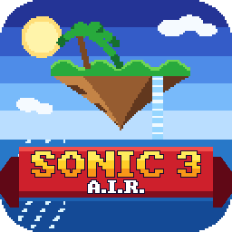
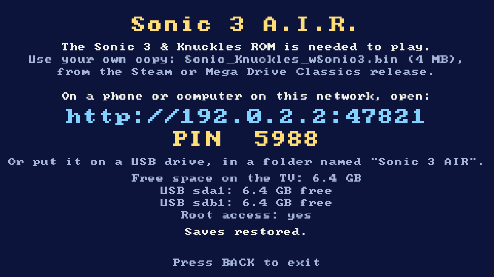
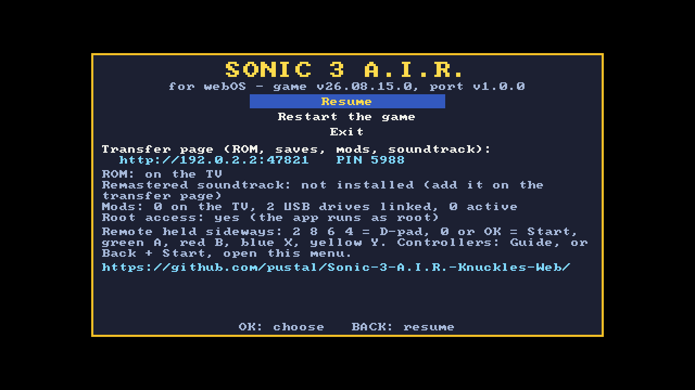
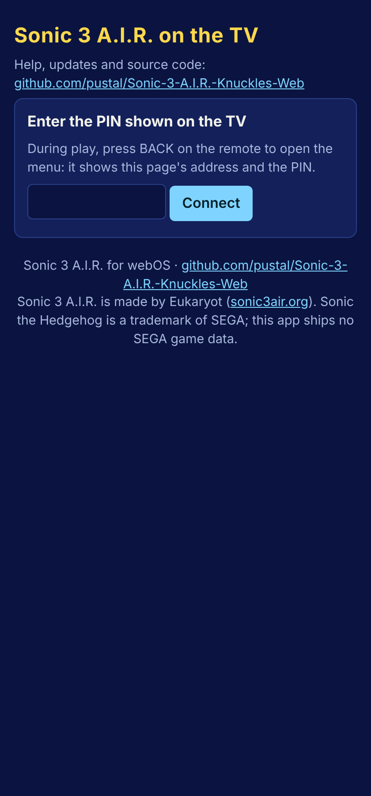
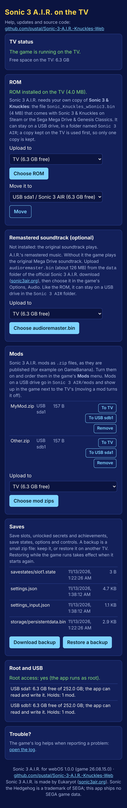

<p align="center"></p>

# Sonic 3 - Angel Island Revisited for WebOS

**Version 1.0.1** · [Sonic 3 - Angel Island Revisited](https://sonic3air.org) (Sonic 3 A.I.R.), Eukaryot's
fan remaster of Sonic 3 & Knuckles, built from [its source code](https://github.com/Eukaryot/sonic3air) as a
**native** app for LG webOS TVs (SDL2, OpenGL ES 2), with a few TV-friendly extras:

- **Bring your own ROM, from your phone.** On first launch the TV shows an address and a PIN.
  Open it on any phone or computer on the same network and upload the Sonic 3 & Knuckles ROM
  from your own copy of the game, to the TV or a USB drive. No SSH needed.
- **Remastered soundtrack, mods and saves** are managed on the same page: add A.I.R.'s
  remastered music, upload mods, download a backup of your saves or restore one.
- **USB drives.** The ROM, the soundtrack and mods can live on a USB drive, and be moved
  between the TV and a drive from the page. On rooted TVs, drives the app cannot reach on its
  own are used through root.
- **Plays with the remote.** Controllers work as usual; the remote is mapped too (below).
- **Back opens the menu** at any time, pausing the game: Resume, Restart the game, Exit, with
  the transfer page's address and PIN, where the files come from, and the controls.

No game assets are included or downloaded by this project.

## Screenshots

These show the app's own screens; none of them contain game graphics.

| First launch on the TV | Menu (Back) |
|---|---|
|  |  |

| Transfer page: PIN | Transfer page |
|---|---|
|  |  |

## What you need

- An LG webOS TV with the [webOS Homebrew Channel](https://github.com/webosbrew/webos-homebrew-channel)
  (or Developer Mode).
- **The Sonic 3 & Knuckles ROM**: the 4 MB image of Sonic & Knuckles locked on to Sonic 3, as a `.bin`
  or `.md` file with any name. Sonic 3 & Knuckles on Steam and the Sega Mega Drive & Genesis Classics
  include it as `Sonic_Knuckles_wSonic3.bin` (in `uncompressed ROMs`). Separate Sonic & Knuckles and
  Sonic 3 ROMs (2 MB each) work too when they are in RetroArch's `roms/megadrive` or `roms/genesis` (below): the app joins
  them. A.I.R. checks the content and accepts only that exact ROM; interleaved `.smd` dumps are not
  accepted.
- Optional: **the remastered soundtrack**, `audioremaster.bin` (about 126 MB), from the `data` folder of
  the official Sonic 3 A.I.R. download at [sonic3air.org](https://sonic3air.org). It is not part of this
  app: the remastered tracks are arrangements of SEGA's music, so, like the ROM, you add them from a
  copy you got yourself. Without it the game plays the original Mega Drive soundtrack. (A.I.R.'s own
  "download remastered soundtrack" option in its Options menu uses the TV's libcurl, if the TV has it.)
- A controller is recommended; the remote works too.

## Install

Download the `.ipk` from the [releases](https://github.com/pustal/Sonic-3-A.I.R.-Knuckles-Web/releases) and
install it with the Homebrew Channel or `ares-install`. Start **Sonic 3 A.I.R.** on the TV. The app is
also listed in the [pustal/webos-repo](https://github.com/pustal/webos-repo) Homebrew Channel repository,
which installs it and its updates from the Homebrew Channel itself.

**Options > Check for updates** in the game looks for a newer release of this app (not of the official
Sonic 3 A.I.R. builds, which do not run on a TV). As the TV has no browser for the game to open,
**Open download page** shows the releases address in the app's menu, to open on a phone or computer;
the Homebrew Channel installs the update.

## First start

The TV shows an address such as `http://192.168.1.20:47821` and a 4-digit PIN. Open the address on a
phone or computer on the same network, enter the PIN and upload the ROM. The game starts on the TV as
soon as it arrives.

Instead, you can put the ROM on a USB drive, in a folder named **`Sonic 3 AIR`**, and plug it in: the
setup screen finds it. A drive set up for RetroArch works as it is: a Sonic 3 & Knuckles ROM in its
`roms/megadrive` or `roms/genesis` folder (see [USB drives](#usb-drives)) is copied to the TV.

The first start compiles the game's scripts, which takes a few seconds; later starts are quicker.

## Remote control

Hold the remote sideways, like a classic pad. The colour buttons match the Xbox controller's buttons of
the same colour:

| Button | Game |
|---|---|
| 2 / 8 / 6 / 4 | Left / Right / Up / Down |
| Green | A (jump) |
| Red | B |
| Blue | X |
| Yellow | Y |
| 0 | Start / Pause |
| Arrow keys, OK | D-pad, Start (unchanged) |
| Back (or Exit) | The menu |

On a controller, the Guide button, or Back and Start together, open the menu. In the menu, move with
the arrows (or 6/4), choose with OK, 0 or A, and resume with Back or B. The mapping lives in
`src/port/RemoteInput.cpp` (`kMappings`). The game's own controls (Options, Controls) still apply on top.

## Transfer page

The page (port 47821, or the next free one) answers only devices on your local network, and only with
the PIN shown on the TV. It shows:

- **ROM**: upload it to the TV or a USB drive, or move it between them. One copy is kept; a copy on
  the TV is used first.
- **Remastered soundtrack**: the same, for `audioremaster.bin`, plus Remove. Choose it in the game's
  Options, Audio.
- **Mods**: upload A.I.R. mods as `.zip` files (as they are published, for example on GameBanana), to
  the TV or a USB drive; move or remove them. Turn them on and order them in the game's **Mods** menu.
- **Saves**: the files of your saves (save slots, unlocked secrets and achievements, save states,
  options and controls), **Download backup** (a small zip file) and **Restore a backup**.
- **Root and USB**: root access and each drive's space and contents.
- **The game's log**, for reporting problems.

A ROM, soundtrack or save backup received while the game runs is used when it starts again: the page
then offers **Restart the game now** (the menu has the same).

## USB drives

A drive keeps the game's files in its `Sonic 3 AIR` folder:

```
Sonic 3 AIR/<rom>.bin or .md             the ROM (any name; Sonic_Knuckles_wSonic3.bin is used first)
Sonic 3 AIR/audioremaster.bin            the remastered soundtrack
Sonic 3 AIR/mods/                        mods (zip files or folders)
```

**RetroArch folders.** As in Webmon, when there is no ROM on the TV or in a `Sonic 3 AIR` folder, the
app also looks in the RetroArch-style `roms/megadrive` and `roms/genesis` folders at the root of each
drive (any capitalisation, and up to two folder levels below them) for `.bin`, `.md` and `.gen` files
with "sonic" in their name (any capitalisation). A 4 MB file that is the Sonic 3 & Knuckles ROM, or a
2 MB Sonic & Knuckles ROM (with "knuckles" in its name) plus a 2 MB Sonic 3 ROM (with "3" in its name),
joined, is checked
and **copied** to the TV, so the game keeps working without the drive. Nothing in the RetroArch folders
is changed. The page and the menu show where the copy came from.

At start-up the app links them where the game looks (a drive's mods appear in the game next to the
TV's). Whether the app can read and write a drive itself depends on the TV's firmware; on a rooted
TV (the app runs as root, or the Homebrew Channel runs root commands for it), drives it cannot reach
on its own are used through root. Saves always stay on the TV.

## Where things are kept

Everything is in the app's own storage (`$HOME/data`), which webOS removes with the app:

```
Sonic3AIR/        the game's app data: ROM, data/audioremaster.bin, mods/, settings, storage/ (saves), savestates/
game/             the game's working folder: links to the game data in the app, saves/scripts.bin (compiled scripts)
transfer_pin.txt  the transfer page's PIN (delete it for a new one)
```

## Building

The toolchain is Linux x86_64 only (on macOS, build inside a Linux VM or container).

```sh
git clone --recursive https://github.com/pustal/Sonic-3-A.I.R.-Knuckles-Web.git
cd Sonic-3-A.I.R.-Knuckles-Web
export WEBOS_SDK=$HOME/arm-webos-linux-gnueabi_sdk-buildroot   # webosbrew toolchain, relocated
npm install -g @webos-tools/cli                                # ares-package
scripts/build-webos.sh
```

The result is `dist/org.sonic3air.webos_<version>_arm.ipk`, with `dist/org.sonic3air.webos.manifest.json`
for the Homebrew Channel. `cmake --build build-webos --target webos-install` installs it on the TV.

Without the webOS toolchain, `cmake -B build && cmake --build build` builds the same app for desktop
Linux (system SDL2 and OpenGL ES 2), which runs from the build folder: handy for working on the
transfer page, the setup screen and the menu. `S3AIR_DATA_DIR` sets its data folder and
`S3AIR_USB_ROOT` a folder whose subfolders stand in for USB drives.

How it fits together:

- `external/sonic3air` is Eukaryot's repository, unchanged. `CMakeLists.txt` builds it as the upstream
  Linux build does with its OpenGL ES option, without ImGui (dev mode windows) and Discord, against
  SDL-webOS; its `main()` becomes `s3air_main()`.
- `src/main.cpp` prepares the data folder, USB drives, the transfer page and the setup screen, then
  runs the game.
- `src/port/SdlHooks.cpp` sees the game's SDL calls first (linker `--wrap`): the remote mapping, the
  menu (drawn inside the game's buffer swap, which pauses the game) and fullscreen.
- `src/port/CurlShim.cpp` loads the TV's libcurl only when the game downloads something.
- `cmake/StageGameData.cmake` ships the game data as plain files (the release packs it into
  `data/*.bin`), without the remastered soundtrack; `webos/oxygenproject.json` makes the game compile
  its scripts from source, caching them on the TV.

## Credits and legal

Sonic 3 A.I.R. is made by [Eukaryot](https://github.com/Eukaryot) and contributors and published under
the GNU GPL v3; this port is published under the same licence (`LICENSE`) and is not made or endorsed by
them. See `THIRD_PARTY_NOTICES.md` for the libraries it uses.

Sonic the Hedgehog, Sonic 3 & Knuckles and their characters, names, music and art are SEGA's. This
project contains and downloads no SEGA game data: you supply your own ROM. It is not affiliated with or
endorsed by SEGA.
